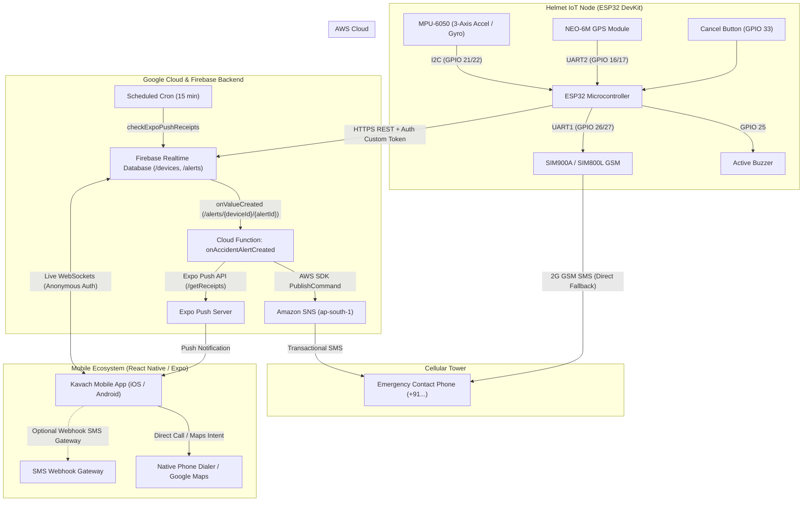
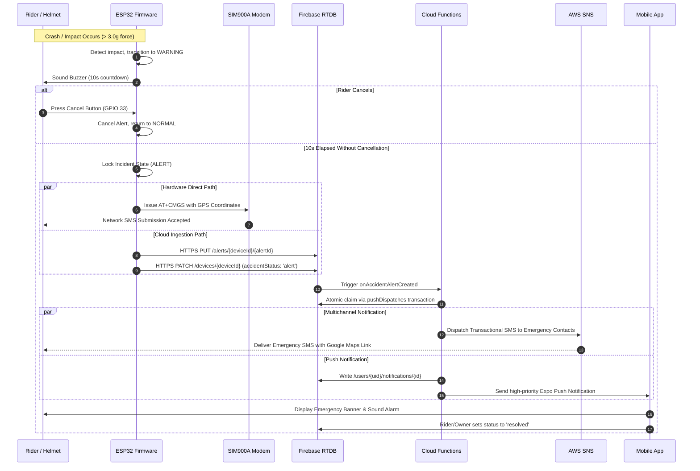

# Kavach (Smart Helmet) — Full Project Overview & System Documentation

> **Kavach** (*Sanskrit for "Armor" or "Shield"*) is an intelligent, IoT-enabled accident detection, emergency dispatch, and rider telemetry ecosystem. It bridges embedded sensors, low-latency cellular communications, Google Firebase real-time cloud services, Amazon Web Services (AWS) SMS infrastructure, and a modern cross-platform React Native (Expo) mobile application to protect two-wheeler riders during the critical "Golden Hour" of emergency response.

---

## Table of Contents

1. [Executive Summary & Problem Statement](#1-executive-summary--problem-statement)
2. [High-Level Architecture & End-to-End Data Flow](#2-high-level-architecture--end-to-end-data-flow)
3. [Hardware & Embedded Firmware Architecture](#3-hardware--embedded-firmware-architecture)
   - [Hardware Component Breakdown](#hardware-component-breakdown)
   - [ESP32 Pinout & Wiring Map](#esp32-pinout--wiring-map)
   - [Firmware Subsystems: KavachHelmet vs. smart_helmet](#firmware-subsystems-kavachhelmet-vs-smart_helmet)
   - [Accident Detection Algorithm & Rider Cancel Window](#accident-detection-algorithm--rider-cancel-window)
   - [Power Constraints & Cellular Power Surges](#power-constraints--cellular-power-surges)
   - [NVS Persistence & Secure Token Management](#nvs-persistence--secure-token-management)
4. [Cloud Backend & Serverless Pipeline](#4-cloud-backend--serverless-pipeline)
   - [Firebase Realtime Database (RTDB) Architecture](#firebase-realtime-database-rtdb-architecture)
   - [Security Rules & Principle of Least Privilege](#security-rules--principle-of-least-privilege)
   - [Cloud Functions (Node.js 20 / v2)](#cloud-functions-nodejs-20--v2)
   - [AWS SNS SMS Infrastructure & Terraform Configuration](#aws-sns-sms-infrastructure--terraform-configuration)
   - [Device Provisioning & Owner Pairing Script](#device-provisioning--owner-pairing-script)
5. [Cross-Platform Mobile Application (React Native / Expo)](#5-cross-platform-mobile-application-react-native--expo)
   - [Technology Stack & Design System](#technology-stack--design-system)
   - [Clean Architecture & Layered Services](#clean-architecture--layered-services)
   - [Dual Runtime Engine: Demo Mode vs. Live Mode](#dual-runtime-engine-demo-mode-vs-live-mode)
   - [Screen Inventory & User Workflows](#screen-inventory--user-workflows)
   - [Client-Side Emergency Dispatch Engine](#client-side-emergency-dispatch-engine)
   - [Push Notification Lifecycle & Deep-Linking](#push-notification-lifecycle--deep-linking)
6. [Database Schema & Data Contracts](#6-database-schema--data-contracts)
   - [Device Telemetry Schema](#device-telemetry-schema)
   - [Accident Alert Schema](#accident-alert-schema)
   - [Emergency Contacts & User Settings Schema](#emergency-contacts--user-settings-schema)
   - [Push Tokens & Dispatch Receipts Schema](#push-tokens--dispatch-receipts-schema)
7. [Quality Assurance, Testing & Validation](#7-quality-assurance-testing--validation)
   - [Node.js Fast Test Suite (In-Memory Firebase)](#nodejs-fast-test-suite-in-memory-firebase)
   - [Firmware C++ Logic Testing](#firmware-c-logic-testing)
   - [Continuous Integration (GitHub Actions)](#continuous-integration-github-actions)
   - [Bench Bring-Up & Hardware Verification Protocol](#bench-bring-up--hardware-verification-protocol)
8. [Installation, Configuration & Deployment Guide](#8-installation-configuration--deployment-guide)
   - [Prerequisites](#prerequisites)
   - [Frontend Configuration & EAS Builds](#frontend-configuration--eas-builds)
   - [Firebase & Cloud Functions Deployment](#firebase--cloud-functions-deployment)
   - [AWS Terraform Provisioning](#aws-terraform-provisioning)
   - [Flashing the ESP32 Firmware](#flashing-the-esp32-firmware)
9. [Repository Structure & Ownership Matrix](#9-repository-structure--ownership-matrix)
10. [Known Limitations, Safety Disclaimers & Future Roadmap](#10-known-limitations-safety-disclaimers--future-roadmap)

---

## 1. Executive Summary & Problem Statement

Two-wheeler accidents constitute over 44% of all fatal road accidents globally. In many cases, casualties occur not from the primary trauma itself, but because victims remain incapacitated without medical assistance, commonly known in emergency medicine as missing the **"Golden Hour"** — the initial 60 minutes following severe physical trauma where immediate medical intervention drastically lowers mortality.

**Kavach** solves this challenge through an autonomous, defense-in-depth safety loop:
1. **Detection**: Integrated tri-axial accelerometers and gyroscopes on the helmet detect abnormal g-force spikes, high rotational acceleration, and loss of equilibrium.
2. **False-Positive Prevention**: An audible audio buzzer warning and a 10-second cancel window give uninjured riders immediate agency to cancel false alarms before notification dispatch.
3. **Redundant Multimodal Alerting**:
   - **Autonomous GSM SMS**: The helmet modem dispatches SMS directly to pre-configured emergency contacts with exact Google Maps coordinates over cellular networks without requiring a tethered smartphone.
   - **Cloud Real-Time Sync**: Telemetry and alert payloads synchronize to Firebase Realtime Database over secure Wi-Fi/cellular.
   - **Cloud Serverless Dispatch**: Cloud Functions trigger AWS SNS transactional SMS dispatches to registered family/guardian contacts and push notifications via Expo/FCM/APNs to linked mobile devices.
4. **Monitoring & Management**: The cross-platform mobile application allows riders and their families to observe live telemetry, GPS location, device health (GSM signal, sensor status, battery level), review past alerts, resolve ongoing incidents, and manage emergency contacts.

---

## 2. High-Level Architecture & End-to-End Data Flow

The Kavach system integrates hardware, edge firmware, cloud infrastructure, and mobile interfaces:



### End-to-End Execution Sequence



---

## 3. Hardware & Embedded Firmware Architecture

The embedded system runs on an Espressif ESP32 dual-core microprocessor, orchestrating multiple sensor buses, power rails, serial lines, and persistent non-volatile storage (NVS).

### Hardware Component Breakdown

| Component | Interface | Role / Purpose | Specifications |
|---|---|---|---|
| **ESP32 DevKit V1** | Master Controller | System orchestration, signal processing, token auth, HTTPS client | Dual Xtensa 32-bit LX6 @ 240 MHz, 520 KB SRAM, 4 MB Flash, 2.4 GHz Wi-Fi (802.11 b/g/n) |
| **MPU-6050** | I2C (Wire) | Tri-axial acceleration & rotational velocity detection | 3-axis gyro (±250, ±500, ±1000, ±2000°/s), 3-axis accelerometer (±2g, ±4g, ±8g, ±16g), 16-bit ADC |
| **NEO-6M GPS** | UART (HardwareSerial 2) | Continuous geospatial positioning | 50-channel u-blox 6 engine, NMEA 0183 standard, update rate 1-5 Hz, cold start 27s |
| **SIM900A / SIM800L** | UART (HardwareSerial 1) | Direct cellular fallback SMS dispatch | Dual-band 900/1800 MHz (SIM900A) or Quad-band (SIM800L), standard AT command set |
| **Active Buzzer** | Digital Output (GPIO) | In-situ acoustic alert during 10s cancellation period | 5V / 3.3V active buzzer, 85 dB @ 10cm |
| **Rider Cancel Button** | Digital Input (Internal Pullup) | Allows rider to cancel false alarms | Normally open momentary tactile switch |
| **On-board LED** | Digital Output | Optical system status indicator | GPIO 2 status indicator |

### ESP32 Pinout & Wiring Map

The physical pins are defined across [`firmware/KavachHelmet/KavachHelmet.ino`](file:///X:/Django/Django_Project/Kavach/firmware/KavachHelmet/KavachHelmet.ino#L31-L36) and [`firmware/smart_helmet/pins.h`](file:///X:/Django/Django_Project/Kavach/firmware/smart_helmet/pins.h):

| Periphery Pin | ESP32 Pin | Function | Notes |
|---|---|---|---|
| **MPU-6050 SDA** | `GPIO 21` | I2C Data | Hardware default I2C bus |
| **MPU-6050 SCL** | `GPIO 22` | I2C Clock | Hardware default I2C bus |
| **MPU-6050 VCC/GND**| `3V3 / GND` | 3.3V Power | Decouple with 100nF capacitor |
| **NEO-6M TX** | `GPIO 16 (RX2)` | UART Receive | Receives NMEA frames at 9600 baud |
| **NEO-6M RX** | `GPIO 17 (TX2)` | UART Transmit | Configuration commands |
| **GSM TXD** | `GPIO 26` | UART Receive | Receives AT responses at 9600 baud |
| **GSM RXD** | `GPIO 27` | UART Transmit | Sends AT commands at 9600 baud |
| **Active Buzzer (+)** | `GPIO 25` | Digital Out | Drive via NPN transistor (e.g., 2N2222) if current > 20 mA |
| **Cancel Button** | `GPIO 33` | Digital In | Configured as `INPUT_PULLUP`; connects to GND on press |
| **Status LED** | `GPIO 2` | Digital Out | ESP32 onboard blue LED |

### Firmware Subsystems: KavachHelmet vs. smart_helmet

The repository contains two firmware iterations in `firmware/`:

```
firmware/
├── KavachHelmet/           <-- Official Production Reference Firmware (Arduino IDE)
│   ├── KavachHelmet.ino    <-- Main firmware sketch
│   ├── README.md           <-- Bring-up instructions & serial setup
│   └── config.example.h    <-- Configuration template (Wi-Fi, API keys, recipient)
├── smart_helmet/           <-- Modular Architecture Prototype with Host PC Unit Tests
│   ├── accident_detector.h <-- Impact physics, moving variance, debounce & cooldown
│   ├── alert_flow.h        <-- State machine: Idle -> Warning -> Alert -> Cooldown
│   ├── alert_sync.h        <-- REST retry queues & Firebase sync
│   ├── sim800.h            <-- Non-blocking AT state machine with SMS delivery reports
│   ├── payloads.h          <-- Static JSON/SMS formatting engine
│   └── tests/              <-- Host PC C++ test suites (runs via `make test`)
├── BRINGUP.md              <-- Physical bench bring-up & hardware testing checklist
└── Makefile                <-- Host testing Makefile
```

1. **[`firmware/KavachHelmet`](file:///X:/Django/Django_Project/Kavach/firmware/KavachHelmet)**:
   - Built to interact with the modern Firebase Security Rules (`database.rules.json`).
   - Uses **Custom Token Authentication**: At provisioning, the device receives a custom token created by the Admin SDK script [`provision-device.js`](file:///X:/Django/Django_Project/Kavach/backend/functions/scripts/provision-device.js).
   - Exchanges this token for an STS ID Token and Refresh Token via Google Identity Toolkit REST API (`https://identitytoolkit.googleapis.com/v1/accounts:signInWithCustomToken`).
   - Stores the refresh token securely in ESP32 Non-Volatile Storage (NVS) using `<Preferences.h>`.
   - Sends telemetry every 10 seconds via HTTPS PATCH to `/devices/{deviceId}.json`.

2. **[`firmware/smart_helmet`](file:///X:/Django/Django_Project/Kavach/firmware/smart_helmet)**:
   - An earlier modular prototype utilizing plain C++ headers with zero Arduino dependencies in its core logic engines.
   - Evaluates SMS Delivery Reports (`+CDS` PDU acknowledgments) over GSM.
   - Includes PC unit tests executed with `g++` and `make test`.

### Accident Detection Algorithm & Rider Cancel Window

Accident detection is evaluated using vector magnitude calculus:

$$\text{Total Acceleration } g = \sqrt{a_x^2 + a_y^2 + a_z^2}$$

- **Warning Threshold**: $g \ge 1.8g$. Indicates severe turbulence, hard braking, or minor impact. Telemetry flags `accidentStatus: "warning"`.
- **Impact Threshold**: $g \ge 3.0g$ (or $3.5g$ in `smart_helmet`). To prevent false positives from potholes, the algorithm in `smart_helmet` requires at least 3 consecutive samples exceeding the threshold within a 50 ms sampling window.
- **Cancel Window (10 seconds)**:
  - An impact transitions the device state machine from `IDLE` to `WARNING`.
  - The active buzzer pulses rapidly ($5\text{ Hz}$).
  - If the rider pushes the cancel button (`GPIO 33`), the alert is suppressed, no SMS is transmitted, no incident record is created in the cloud, and the device transitions back to normal monitoring.
- **Cooldown Interval (60 seconds)**:
  - Following an alert dispatch, a 60-second cooldown is enforced to prevent cascading alerts from subsequent vibrations as the vehicle comes to a halt.

### Power Constraints & Cellular Power Surges

> [!WARNING]
> **SIM800L / SIM900A Power Supply Vulnerability**:
> GSM modems transmit burst RF power in 2G TDMA slots, drawing up to **2.0 Amperes** in sub-millisecond bursts.
> - **Never** power the GSM module directly from the ESP32 DevKit's 3.3V or 5V LDO pin. This induces an immediate brownout, resetting the ESP32.
> - **Required Power Topology**: Power the GSM modem using an independent 3.7V - 4.2V Li-ion battery or a high-current buck regulator (minimum 2.5A continuous output).
> - Place a **$1000\ \mu\text{F}$ low-ESR electrolytic capacitor** in parallel with a $100\text{ nF}$ ceramic capacitor directly across the GSM module's VCC and GND pins.
> - Ensure a **common ground** between the ESP32, GSM modem, MPU-6050, and GPS module.

### NVS Persistence & Secure Token Management

The ESP32 leverages internal flash Non-Volatile Storage (Preferences partition) for fail-safe state recovery across unexpected power disconnects:
- `refresh`: Persistent Firebase refresh token.
- `pendingId`: Unique alert UUID generated during an accident.
- `pendingData`: Serialized JSON payload containing timestamp, latitude, longitude, and g-force magnitude.
- `pendingStage`: Current stage in the upload lifecycle (`0 = unsent`, `1 = alert record written`, `2 = smsStatus confirmed`).
- `pendingSms`: Status of modem dispatch (`pending`, `confirmed`, `failed`, `unknown`).

If the ESP32 loses power or network connectivity mid-crash, it re-reads these keys upon reboot and automatically resumes the alert upload without duplicating the alert ID or re-transmitting redundant SMS messages.

---

## 4. Cloud Backend & Serverless Pipeline

The backend lives in `backend/` and leverages Firebase Realtime Database, Cloud Functions (2nd Gen), and Terraform-managed AWS Simple Notification Service (SNS).

### Firebase Realtime Database (RTDB) Architecture

```
/
├── devices/
│   └── {deviceId}/                           <-- ESP32 writes telemetry; Owner reads
│       ├── deviceId: string
│       ├── helmetStatus: "connected" | "disconnected"
│       ├── accidentStatus: "normal" | "warning" | "alert"
│       ├── latitude: number | null
│       ├── longitude: number | null
│       ├── gpsValid: boolean
│       ├── gpsLastFixAt: string (ISO-8601)
│       ├── gsmRegistered: boolean
│       ├── mpuOk: boolean
│       ├── batteryLevel: number | null
│       ├── alcoholDetected: boolean | null
│       └── lastUpdated: string (ISO-8601)
├── alerts/
│   └── {deviceId}/
│       └── {alertId}/                        <-- ESP32 creates; Owner can update status to 'resolved'
│           ├── deviceId: string
│           ├── timestamp: string (ISO-8601)
│           ├── severity: "low" | "medium" | "high"
│           ├── latitude: number | null
│           ├── longitude: number | null
│           ├── gpsValid: boolean
│           ├── status: "new" | "sent" | "resolved"
│           ├── smsStatus: "pending" | "confirmed" | "failed" | "unknown"
│           ├── smsDispatchedAt: number (ms)
│           └── resolvedAt: string (ISO-8601)
├── deviceOwners/
│   └── {deviceId}/
│       └── {uid}: true                       <-- Admin-only mapping connecting owners to helmets
├── users/
│   └── {uid}/
│       ├── profile/
│       │   └── name: string
│       ├── contacts/
│       │   └── {contactId}/                  <-- Private emergency contacts (E.164)
│       │       ├── name: string
│       │       ├── phone: string (+91...)
│       │       └── isPrimary: boolean
│       ├── notifications/
│       │   └── {notificationId}/             <-- In-app notification center inbox
│       │       ├── type: "accident" | "disconnected" | "gps" | "sensor"
│       │       ├── title: string
│       │       ├── body: string
│       │       ├── timestamp: string (ISO)
│       │       ├── read: boolean
│       │       ├── alertId: string
│       │       └── deviceId: string
│       ├── settings/
│       │   └── notifications/
│       │       ├── push: boolean
│       │       └── sound: boolean
│       └── pushTokens/
│           └── {tokenId}/                    <-- Validated Expo Push Tokens
│               ├── token: string
│               ├── platform: "android" | "ios"
│               └── updatedAt: string
├── pushDispatches/
│   └── {deviceId}/
│       └── {alertId}/                        <-- Idempotency lock for Cloud Functions
│           ├── status: "sending" | "sent" | "failed"
│           └── startedAt: number
├── pushReceipts/
│   └── {uid}/
│       └── {ticketId}/                       <-- Expo push tickets monitored by scheduled cron
└── smsDispatches/
    └── {deviceId}/
        └── {alertId}/                        <-- AWS SNS delivery outcome records
```

### Security Rules & Principle of Least Privilege

Defined in [`backend/firebase/database.rules.json`](file:///X:/Django/Django_Project/Kavach/backend/firebase/database.rules.json):
- **Universal Lockdown**: Top-level `.read: false` and `.write: false`.
- **Owner Verification**: App clients can only read `/devices/{deviceId}` and `/alerts/{deviceId}` if their authenticated UID exists in `/deviceOwners/{deviceId}/{auth.uid}`.
- **Hardware Isolation**: The helmet writes only to its own device node and creates alerts if its JWT contains the custom claim `auth.token.device_id === $deviceId`.
- **Field-Level Immutability**: App clients cannot alter telemetry or overwrite alert fields. The *only* write permission granted to an owner on an alert record is changing `status` to `"resolved"`.
- **User Scoping**: Everything under `/users/{uid}/*` is strictly locked to `auth.uid === $uid`. Cross-user data leakage is physically impossible under the database engine.
- **Regex Validation**:
  - Contacts require valid E.164 international phone strings: `/^\+[1-9][0-9]{7,14}$/`.
  - Push tokens require standard Expo token syntax: `/^Expo(nent)?PushToken\[[A-Za-z0-9_-]+\]$/`.

### Cloud Functions (Node.js 20 / v2)

Defined in [`backend/functions/index.js`](file:///X:/Django/Django_Project/Kavach/backend/functions/index.js):

1. **[`onAccidentAlertCreated`](file:///X:/Django/Django_Project/Kavach/backend/functions/index.js#L136-L162)**:
   - Realtime Database trigger on `/alerts/{deviceId}/{alertId}` with automatic retry enabled.
   - **Distributed Locking**: Executes an atomic transaction on `pushDispatches/{deviceId}/{alertId}`. If an invocation is currently `sending` or has completed `sent`, parallel executions immediately abort to eliminate duplicate push notifications and duplicate SMS charges.
   - **Notification Center Ingestion**: Hashes the alert ID and writes a persistent in-app notification record under `users/{ownerUid}/notifications/`.
   - **AWS SNS Dispatch**: Fetches the owner's emergency contact list and calls [`dispatchEmergencySms`](file:///X:/Django/Django_Project/Kavach/backend/functions/awsSns.js#L94-L127). Writes delivery records back to `/smsDispatches/` and updates `/alerts/{deviceId}/{alertId}/smsStatus`.
   - **Expo Push Dispatch**: If the owner has opted in (`settings/notifications/push !== false`), formats a high-priority push message payload:
     ```json
     {
       "to": "ExponentPushToken[xxxxxxxxxxxxxxxxxxxxxx]",
       "title": "Accident detected",
       "body": "Location: 12.97159, 77.59456",
       "data": { "type": "accident", "alertId": "alert_001", "deviceId": "HELMET_001" },
       "priority": "high",
       "channelId": "default",
       "sound": "default"
     }
     ```
   - Records Expo ticket IDs to `pushReceipts/{uid}/{ticketId}`.

2. **[`checkExpoPushReceipts`](file:///X:/Django/Django_Project/Kavach/backend/functions/index.js#L164-L215)**:
   - Scheduled cron job running every 15 minutes (`every 15 minutes`).
   - Polls `https://exp.host/--/api/v2/push/getReceipts` in batches of 100 for push tickets older than 15 minutes.
   - Automatically prunes invalid device tokens (`DeviceNotRegistered`) from the user's registered tokens to maintain database cleanliness.

### AWS SNS SMS Infrastructure & Terraform Configuration

The project provisions AWS infrastructure using Terraform in [`terraform/`](file:///X:/Django/Django_Project/Kavach/terraform):
- **IAM Identity**: Creates a dedicated service user `kavach-firebase-sns-dispatcher` ([`terraform/main.tf`](file:///X:/Django/Django_Project/Kavach/terraform/main.tf#L1-L3)).
- **Least-Privilege Policy**: Attaches permissions limited exclusively to `sns:Publish` and `sns:SetSMSAttributes` / `sns:GetSMSAttributes`.
- **Transactional Delivery Tier**: Configures default SMS delivery attributes to `Transactional` for carrier-priority routing during critical life-safety alerts.
- **Regional Deployment**: Defaults to `ap-south-1` (AWS Mumbai) for low-latency dispatch in India.

### Device Provisioning & Owner Pairing Script

Because the mobile application intentionally omits an insecure in-app pairing mechanism, helmet-to-owner relationships are established through an authenticated administrative script: [`backend/functions/scripts/provision-device.js`](file:///X:/Django/Django_Project/Kavach/backend/functions/scripts/provision-device.js).

**Usage Execution**:
```bash
node scripts/provision-device.js HELMET_001 <ANONYMOUS_USER_UID>
```

**Script Actions**:
1. Creates or verifies a Firebase Authentication account for the helmet: `helmet-helmet_001`.
2. Authorizes the owner by setting `deviceOwners/HELMET_001/<ANONYMOUS_USER_UID> = true`.
3. Issues a cryptographically signed Firebase Custom Token containing the claim:
   ```json
   {
     "device_id": "HELMET_001"
   }
   ```
4. Prints the custom token to stdout. The developer/technician inputs this token into the ESP32 serial interface once during bench provisioning.

---

## 5. Cross-Platform Mobile Application (React Native / Expo)

The frontend is an Expo-managed React Native application (`frontend/`) optimized for Android-first execution and iOS compatibility.

### Technology Stack & Design System

- **Framework**: React 19, React Native 0.86, Expo SDK 57/58.
- **Navigation**: React Navigation v7 (`@react-navigation/native`, `@react-navigation/native-stack`, `@react-navigation/bottom-tabs`).
- **Icons & Visuals**: `@expo/vector-icons` (Ionicons), custom curated design system in [`frontend/src/constants/theme.js`](file:///X:/Django/Django_Project/Kavach/frontend/src/constants/theme.js).
- **Design Tokens**:
  - Palette: Deep Navy (`#0F172A`), Safety Red (`#DC2626`), Crimson (`#EF4444`), Emerald Green (`#16A34A`), Warning Amber (`#D97706`), Ice Blue Slate (`#F8FAFC`).
  - Accessibility: Minimum touch targets enforced at 48x48 dp (`MIN_TOUCH`). High-contrast typography and semantic status tones (`red`, `orange`, `green`, `blue`, `grey`).

### Clean Architecture & Layered Services

The application enforces a strict unidirectional data flow:

```
[ UI Layer: Screens & Components ]
             |
             v
     [ React Hooks Layer ]
 (useDevice, useAlerts, useContacts, useNotifications, useSettings, useDemoControls)
             |
             v
    [ Domain Service Layer ]
 (deviceService, alertService, contactService, inboxService, settingsService)
             |
             v
   [ Integration Adapters ]
   ├── demoStore.js  <--- (In-Memory Mock Engine with 10 Scenarios)
   └── liveAdapter.js -> firebaseService.js <--- (Live Firebase RTDB + Auth)
```

**Architectural Rules**:
1. Screens never import Firebase or SDK modules directly.
2. Screens consume pure data and dispatch actions through custom hooks.
3. Services validate all inputs and emit strongly-typed [`ServiceError`](file:///X:/Django/Django_Project/Kavach/frontend/src/services/serviceError.js) exceptions (`INVALID_NAME`, `INVALID_PHONE`, `DUPLICATE_PHONE`, `NOT_FOUND`, `LIVE_NOT_CONNECTED`).

### Dual Runtime Engine: Demo Mode vs. Live Mode

The application behavior is governed by the environment flag `EXPO_PUBLIC_DATA_SOURCE`:

| Dimension | Demo Mode (`EXPO_PUBLIC_DATA_SOURCE=demo`) | Live Mode (`EXPO_PUBLIC_DATA_SOURCE=live`) |
|---|---|---|
| **Data Source** | In-memory reactive store ([`demoStore.js`](file:///X:/Django/Django_Project/Kavach/frontend/src/services/demoStore.js)) | Firebase Realtime Database ([`firebaseService.js`](file:///X:/Django/Django_Project/Kavach/frontend/src/services/firebaseService.js)) |
| **Authentication**| Mock user (`demo-user`) | Persistent anonymous Firebase Auth stored in `AsyncStorage` |
| **Network Need** | 100% offline, zero internet or hardware required | Requires live Firebase connection |
| **Push / Permissions**| Disabled; no native permission prompts | Initializes Expo Push Token and uploads to `/users/{uid}/pushTokens` |
| **Failure Behavior**| Always loads mock state | Displays explicit `LIVE_NOT_CONNECTED` screen if config is missing; **never falls back to fake data** |
| **Demo Switcher** | Floating bottom scenario bar and Profile selector | Completely stripped from UI |

#### 10 Realistic Demo Scenarios
In Demo mode, developers and stakeholders can cycle through all hardware edge states using `useDemoControls().setScenario(name)`:
1. `normal`: Helmet connected, GPS fix valid, zero accidents.
2. `newAlert`: Active, unacknowledged high-severity impact alert with map coordinates.
3. `gpsUnavailable`: Helmet connected, impact detected, but GPS fix has zero satellites (null coordinates).
4. `gpsStale`: GPS fix was acquired > 5 minutes ago; location tagged as stale.
5. `offline`: Helmet lost power or cellular connection (> 30s elapsed).
6. `sensorFault`: MPU-6050 I2C bus error (`mpuOk: false`).
7. `gsmUnregistered`: SIM card rejected or cellular tower out of reach (`gsmRegistered: false`).
8. `backendUnreachable`: Cloud Realtime Database outage simulator.
9. `batterySupported`: Helmet operating with battery level telemetry.
10. `emptyDevice`: Unprovisioned fresh device state.

### Screen Inventory & User Workflows

```
App Launch
    ├── SplashScreen (Checks onboarding flag in AsyncStorage)
    ├── OnboardingScreen (Interactive intro carousels; sets onboarding complete)
    └── Main Navigation (Bottom Tabs)
        ├── Home (DashboardScreen)
        │   ├── Helmet Status Card (Connected / Disconnected / Warning / Alert)
        │   ├── Live Metric Pills (GSM, Sensors, Battery, GPS status)
        │   ├── Emergency Fast-Dialer (One-touch calling to primary contacts)
        │   ├── Recent Incident Cards (Quick navigation to details)
        │   └── Header Modals -> NotificationsScreen & ProfileScreen
        ├── Location (LocationScreen)
        │   ├── Real-time Map Coordinates View
        │   ├── Accuracy / Satellites / Timestamp Indicators
        │   └── Open External Route Button (Launches native Google Maps / Apple Maps)
        ├── Alerts (AlertsScreen)
        │   ├── Filterable Incident Feed (All, Active, Resolved)
        │   └── Incident Summary Cards (Timestamp, Severity, Delivery Status)
        ├── Contacts (ContactsScreen)
        │   ├── Priority Contact List (Star for Primary)
        │   ├── Quick Call & Delete Swipe Actions
        │   └── Floating Action Button -> ContactFormScreen (Add/Edit Contact)
        └── Settings (DeviceSettingsScreen)
            ├── Device Hardware Information & Firmware Version
            ├── Notification Preference Toggles (Push, Sound)
            └── Disconnect / Diagnostics Information
```

### Client-Side Emergency Dispatch Engine

Implemented in [`frontend/src/services/emergencyNotificationService.js`](file:///X:/Django/Django_Project/Kavach/frontend/src/services/emergencyNotificationService.js):
- **Incident Confidence Scoring**: Evaluates alerts using `computeAlertConfidence(alert)`. Assigns 0.95 for high severity, 0.75 for medium, and 0.35 for low. Notifications are only dispatched if confidence meets the threshold (default `0.60`).
- **Idempotency & Deduplication**: Dispatched incidents are tracked by `alertId` in memory and persisted to `@kavach:emergency_dispatches` in `AsyncStorage`. Duplicate dispatches for the same incident are rejected.
- **SMS Gateway Boundary**:
  - Connects to a third-party SMS webhook endpoint via `EXPO_PUBLIC_EMERGENCY_SMS_GATEWAY_URL`.
  - When unconfigured, the app updates state to `unconfigured` and displays the [`EmergencyDispatchBanner`](file:///X:/Django/Django_Project/Kavach/frontend/src/components/EmergencyDispatchBanner.js).
  - Provides a one-tap fallback button opening the smartphone's native SMS application with pre-filled coordinates: `sms:+91...?body=EMERGENCY ALERT: Accident detected at https://www.google.com/maps?q=...`.

### Push Notification Lifecycle & Deep-Linking

Configured across [`frontend/src/services/notificationService.js`](file:///X:/Django/Django_Project/Kavach/frontend/src/services/notificationService.js) and [`frontend/src/navigation/AppNavigator.js`](file:///X:/Django/Django_Project/Kavach/frontend/src/navigation/AppNavigator.js):
1. **Permission Request**: Triggered after onboarding completion.
2. **Token Registration**: Obtains `ExpoPushToken` via `Notifications.getExpoPushTokenAsync({ projectId })`.
3. **Database Scoping**: Writes token to `/users/{uid}/pushTokens/{tokenId}`.
4. **Deep-Linking**: Notification response listeners inspect incoming payload `{ type: "accident", alertId }` and immediately navigate the user directly to `AlertDetailsScreen` for that incident.

---

## 6. Database Schema & Data Contracts

### Device Telemetry Schema

Location: `/devices/{deviceId}`

```typescript
interface DeviceTelemetry {
  deviceId: string;                   // E.g., "HELMET_001"
  helmetStatus: "connected" | "disconnected"; // Derived as disconnected if > 30s silent
  accidentStatus: "normal" | "warning" | "alert";
  latitude: number | null;            // Finite float (null if gpsValid is false)
  longitude: number | null;           // Finite float (null if gpsValid is false)
  gpsValid: boolean;                  // True only if GPS fix is active and < 10s old
  gpsLastFixAt: string | null;        // ISO-8601 UTC string
  gsmRegistered: boolean;             // True if SIM is attached to cellular network
  mpuOk: boolean;                     // True if I2C communication with MPU-6050 succeeds
  batteryLevel: number | null;        // Percentage (0 - 100) or null if unmetered
  alcoholDetected: boolean | null;    // Boolean flag or null if sensor unequipped
  lastUpdated: string;                // ISO-8601 UTC timestamp
}
```

### Accident Alert Schema

Location: `/alerts/{deviceId}/{alertId}`

```typescript
interface AccidentAlert {
  deviceId: string;                   // E.g., "HELMET_001"
  timestamp: string;                  // ISO-8601 UTC timestamp of crash event
  severity: "low" | "medium" | "high";
  latitude: number | null;            // Coordinates at moment of impact
  longitude: number | null;
  gpsValid: boolean;
  status: "new" | "sent" | "resolved"; // "resolved" is settable by mobile app owners
  smsStatus: "pending" | "confirmed" | "failed" | "unknown";
  smsDispatchedAt?: number;           // Unix millisecond timestamp
  resolvedAt?: string;                // ISO-8601 UTC timestamp
  confidence?: number;                // Float between 0.0 and 1.0
}
```

### Emergency Contacts & User Settings Schema

Location: `/users/{uid}/contacts/{contactId}` and `/users/{uid}/settings`

```typescript
interface EmergencyContact {
  id?: string;
  name: string;                       // String, 1 to 80 characters
  phone: string;                      // Normalized E.164 string (e.g., "+919876543210")
  isPrimary: boolean;                 // Primary contact flag
  createdAt?: string;
}

interface UserSettings {
  notifications: {
    push: boolean;                    // Enable/disable remote push notifications
    sound: boolean;                   // Enable/disable audible alert sounds
  };
  accidentThreshold?: number | null;  // Read-only in app UI
}
```

### Push Tokens & Dispatch Receipts Schema

Location: `/users/{uid}/pushTokens/{tokenId}` and `/pushReceipts/{uid}/{ticketId}`

```typescript
interface PushTokenRecord {
  token: string;                      // Matches /^Expo(nent)?PushToken\[[A-Za-z0-9_-]+\]$/
  platform: "android" | "ios";
  updatedAt: string;                  // ISO-8601 string
}

interface PushReceiptRecord {
  tokenId: string;
  createdAt: number;                  // Unix millisecond timestamp
}
```

---

## 7. Quality Assurance, Testing & Validation

The Kavach repository implements an enterprise-grade testing architecture spanning firmware unit tests, contract checks, in-memory Firebase simulations, and static linting.

```
Testing Pipeline
├── Frontend Fast Test Suite (`frontend/tests/`)
│   ├── demo-data-layer.test.js      <-- Phone/name validation, scenario states, CRUD
│   ├── hooks.test.js                <-- React data hooks behavior without UI rendering
│   ├── live-firebase.test.js        <-- In-memory Firebase RTDB live adapter tests
│   ├── live-not-configured.test.js  <-- Prevents fallback to mock data on config failure
│   ├── firmware-contract.test.js    <-- Validates payload compatibility with RTDB rules
│   ├── emergency-notifications.test.js <-- Confidence scoring, deduplication, retry logic
│   └── static.test.js               <-- Enforces path consistency, casing, gitignore rules
├── Backend Rules Tests (`backend/functions/`)
│   └── npm run test:rules           <-- Firebase Emulator Suite security rule tests
└── Firmware Logic Tests (`firmware/`)
    └── make test                    <-- Host C++ tests (accident detection, GSM state machine)
```

### Node.js Fast Test Suite (In-Memory Firebase)

The test suite in [`frontend/tests/`](file:///X:/Django/Django_Project/Kavach/frontend/tests) does not depend on Jest, browser emulators, or active internet connections. It leverages Node.js's native test runner (`node:test`) and bundles test files via `esbuild`:
- **In-Memory Fakes** ([`frontend/tests/fakes`](file:///X:/Django/Django_Project/Kavach/frontend/tests/fakes)): Complete mock implementations of `firebase/app`, `firebase/auth`, `firebase/database`, `react-native`, and `@react-native-async-storage/async-storage`.
- **Contract Verification**: Tests in [`firmware-contract.test.js`](file:///X:/Django/Django_Project/Kavach/frontend/tests/firmware-contract.test.js) load actual JSON output generated by the C++ firmware ([`firmware-payloads.json`](file:///X:/Django/Django_Project/Kavach/frontend/tests/fixtures/firmware-payloads.json)) and verify that every payload satisfies the Firebase security rules and formats correctly in the app.
- **Execution**: Runs in ~10 seconds.
  ```bash
  cd frontend
  npm test
  ```

### Firmware C++ Logic Testing

The modular prototype logic in [`firmware/smart_helmet/`](file:///X:/Django/Django_Project/Kavach/firmware/smart_helmet) is built to compile on host development computers using standard `g++` (GCC) without Arduino dependencies:
```bash
cd firmware
make test
```
Tests evaluate:
- Vector impact math against standard g-force profiles.
- 10-second cancel window timer mechanics.
- Non-blocking GSM AT command parser state transitions.
- SMS delivery report (`+CDS`) extraction.

### Continuous Integration (GitHub Actions)

Defined in [`.github/workflows/ci.yml`](file:///X:/Django/Django_Project/Kavach/.github/workflows/ci.yml):
- Triggers on every `push` and `pull_request`.
- Job 1 (`app`): Installs dependencies in `frontend/` and executes `npm test`.
- Job 2 (`firmware`): Executes `make -C firmware test` on Ubuntu runners.

### Bench Bring-Up & Hardware Verification Protocol

Detailed in [`firmware/BRINGUP.md`](file:///X:/Django/Django_Project/Kavach/firmware/BRINGUP.md):
1. **Power Check**: Measure GSM VCC with an oscilloscope during transmission; verify dip does not drop below 3.6V.
2. **I2C Scanner**: Verify MPU-6050 responds at address `0x68` (or `0x69`).
3. **GPS Open Sky**: Place the NEO-6M antenna near an exterior window; confirm NMEA `$GPRMC` sentence fix within 60 seconds.
4. **Impact Simulation**: Bench test without striking a human; trigger test impact using a calibrated rubber fixture or serial debug character `'t'`.
5. **Failover Recovery**: Kill Wi-Fi hotspot during alert dispatch; confirm alert persists in NVS and flushes immediately when connectivity returns.

---

## 8. Installation, Configuration & Deployment Guide

### Prerequisites

- **Node.js**: LTS version (v20.x or higher)
- **Package Manager**: npm or bun
- **Mobile Environment**: Android device with **Expo Go** or an EAS development build
- **Cloud Tools**:
  - Firebase CLI (`npm install -g firebase-tools`)
  - AWS CLI (`aws configure`)
  - Terraform CLI (`>= 1.0`)
- **Hardware Tools**: Arduino IDE 2.x with the **Espressif ESP32** board package installed

---

### Frontend Configuration & EAS Builds

1. Navigate to the frontend directory:
   ```bash
   cd frontend
   npm install
   ```

2. Configure environment variables in `frontend/.env.local`:
   ```dotenv
   # Choose 'demo' for mock data or 'live' for real Firebase
   EXPO_PUBLIC_DATA_SOURCE=live
   EXPO_PUBLIC_DEVICE_ID=HELMET_001

   # EAS Project ID (Required for remote push notifications)
   EXPO_PUBLIC_EAS_PROJECT_ID=your-eas-project-uuid

   # Firebase Web Configuration
   EXPO_PUBLIC_FIREBASE_API_KEY=AIzaSy...
   EXPO_PUBLIC_FIREBASE_AUTH_DOMAIN=your-project.firebaseapp.com
   EXPO_PUBLIC_FIREBASE_DATABASE_URL=https://your-project-default-rtdb.firebaseio.com
   EXPO_PUBLIC_FIREBASE_PROJECT_ID=your-project
   EXPO_PUBLIC_FIREBASE_STORAGE_BUCKET=your-project.appspot.com
   EXPO_PUBLIC_FIREBASE_MESSAGING_SENDER_ID=1234567890
   EXPO_PUBLIC_FIREBASE_APP_ID=1:1234567890:web:abcdef

   # Optional Client SMS Webhook Gateway
   EXPO_PUBLIC_EMERGENCY_SMS_GATEWAY_URL=
   EXPO_PUBLIC_EMERGENCY_SMS_API_KEY=
   ```

3. Start the local Metro bundler:
   ```bash
   npx expo start -c
   ```

4. Building a Standalone Android APK ([`docs/ANDROID_BUILD.md`](file:///X:/Django/Django_Project/Kavach/docs/ANDROID_BUILD.md)):
   ```bash
   npx eas-cli@latest build --profile preview --platform android
   ```

---

### Firebase & Cloud Functions Deployment

1. Initialize and authenticate with Firebase:
   ```bash
   firebase login
   firebase use --add your-project-id
   ```

2. Deploy Database Security Rules and Cloud Functions ([`backend/firebase/SETUP.md`](file:///X:/Django/Django_Project/Kavach/backend/firebase/SETUP.md)):
   ```bash
   cd backend
   npm --prefix functions install
   firebase deploy --only database,functions
   ```

3. Provision your mobile client UID to own the helmet:
   ```bash
   cd functions
   # Replace with your actual database URL and service account key
   node scripts/provision-device.js HELMET_001 <YOUR_ANONYMOUS_APP_UID>
   ```
   *The script outputs the one-time custom token needed by the ESP32.*

---

### AWS Terraform Provisioning

1. Navigate to the terraform directory:
   ```bash
   cd terraform
   terraform init
   terraform plan
   terraform apply
   ```

2. Retrieve the programmatic access keys:
   ```bash
   terraform output -raw aws_secret_access_key
   ```

3. Set the AWS credentials in Google Cloud Functions environment variables / secrets manager:
   ```bash
   firebase functions:secrets:set AWS_ACCESS_KEY_ID
   firebase functions:secrets:set AWS_SECRET_ACCESS_KEY
   firebase functions:secrets:set AWS_REGION
   ```

4. **Verify AWS SNS Sandbox Destination Numbers**:
   - Because AWS accounts start in SMS Sandbox mode, navigate to the AWS SNS Console in `ap-south-1`.
   - Under **Text messaging (SMS)** $\rightarrow$ **Sandbox destination phone numbers**, add and verify each emergency contact number with an OTP.

---

### Flashing the ESP32 Firmware

1. Open **Arduino IDE**.
2. Go to **Settings** $\rightarrow$ Additional Board Manager URLs: Add `https://raw.githubusercontent.com/espressif/arduino-esp32/gh-pages/package_esp32_index.json`.
3. Install the **esp32** board platform and the following libraries:
   - `Adafruit MPU6050`
   - `Adafruit Unified Sensor`
   - `TinyGPSPlus`
   - `ArduinoJson` (v7.x)
4. Open [`firmware/KavachHelmet/KavachHelmet.ino`](file:///X:/Django/Django_Project/Kavach/firmware/KavachHelmet/KavachHelmet.ino).
5. Copy `config.example.h` to `config.h` and populate:
   - Wi-Fi credentials (`WIFI_SSID`, `WIFI_PASSWORD`).
   - Firebase Realtime Database URL & API Key.
   - Device ID (`HELMET_001`).
   - Emergency SMS recipient (`SMS_RECIPIENT_E164`).
6. Select **Board**: "ESP32 Dev Module", choose the corresponding COM/TTY port, and click **Upload**.
7. Open the **Serial Monitor** at **115200 baud**. When prompted, paste the custom token obtained from `provision-device.js` and press Enter. The token will be saved to NVS and authenticated.

---

## 9. Repository Structure & Ownership Matrix

### Directory Layout

```
Kavach/
├── .github/
│   └── workflows/
│       └── ci.yml               # Automated GitHub Actions test pipeline
├── backend/
│   ├── firebase.json            # Firebase deployment targets
│   ├── firebase/
│   │   ├── SETUP.md             # End-to-end backend setup guide
│   │   └── database.rules.json  # Comprehensive RTDB security rules
│   └── functions/
│       ├── package.json         # Cloud Functions dependencies
│       ├── index.js             # onAccidentAlertCreated & checkExpoPushReceipts
│       ├── awsSns.js            # Amazon SNS SMS dispatch client
│       ├── expoPush.js          # Expo push notification dispatcher
│       └── scripts/
│           └── provision-device.js # Admin script to link owner & device
├── docs/
│   ├── ANDROID_BUILD.md         # EAS Android APK build instructions
│   ├── DEMO_GUIDE.md            # Interactive walkthrough of 10 demo states
│   ├── INTEGRATION_NOTES.md     # Cross-subsystem integration notes
│   ├── PERSON3_README.md        # Data layer architecture reference
│   └── TESTING.md               # Testing guide & checklist
├── firmware/
│   ├── BRINGUP.md               # Bench testing & hardware bring-up manual
│   ├── Makefile                 # C++ unit tests build script
│   ├── README.md                # Firmware overview & wiring notes
│   ├── KavachHelmet/            # Arduino IDE production reference firmware
│   │   ├── KavachHelmet.ino     # Production ESP32 firmware sketch
│   │   ├── README.md            # Provisioning & serial setup guide
│   │   └── config.example.h     # Configuration header template
│   └── smart_helmet/            # Modular prototype with PC-testable logic
│       ├── accident_detector.h  # Impact physics & vector mathematics
│       ├── alert_flow.h         # Cancel window & state machine
│       ├── alert_sync.h         # Queueing & Firebase REST sync
│       ├── sim800.h             # Non-blocking AT command driver
│       └── tests/               # PC unit tests for firmware logic
├── frontend/
│   ├── App.js                   # Application root
│   ├── app.json / app.config.js # Expo configuration & push plugins
│   ├── eas.json                 # EAS build profiles (preview, development)
│   ├── package.json             # Frontend dependencies
│   ├── src/
│   │   ├── config.js            # Global configuration (mode, timeouts)
│   │   ├── components/          # Reusable UI widgets & cards
│   │   ├── constants/           # Design system tokens & colors
│   │   ├── data/                # Initial seed data for demo scenarios
│   │   ├── hooks/               # React data hooks (useDevice, useAlerts, etc.)
│   │   ├── navigation/          # React Navigation 7 Tab and Stack navigators
│   │   ├── screens/             # Application screens (Dashboard, Location, etc.)
│   │   ├── services/            # Domain services, live adapter, demo store
│   │   └── utils/               # Time formatters, phone validators, map links
│   └── tests/                   # In-memory test suites & fixtures
└── terraform/
    ├── README.md                # AWS SNS infrastructure manual
    ├── main.tf                  # IAM user, policies & SMS preferences
    ├── outputs.tf               # Terraform output variables
    └── variables.tf             # AWS configuration variables
```

### Team Responsibility Matrix

The codebase was constructed with clear modular ownership boundaries across three functional tracks:

| Role / Track | Components & Files Owned | Key Deliverables |
|---|---|---|
| **Track 1 (UI & App Shell)** | `frontend/App.js`, `frontend/src/navigation/`, `frontend/src/components/`, `frontend/src/screens/` (`DashboardScreen`, `DeviceSettingsScreen`, `NotificationsScreen`, `ProfileScreen`, `SplashScreen`, `OnboardingScreen`) | Responsive mobile UI, accessibility compliance, visual design system, navigation hierarchy, tab routing. |
| **Track 2 (Backend & Cloud Integration)** | `backend/` (`database.rules.json`, `functions/`), `frontend/src/screens/` (`LocationScreen`, `AlertsScreen`, `AlertDetailsScreen`, `ContactsScreen`, `ContactFormScreen`), `frontend/src/services/` (`firebaseService.js`, `notificationService.js`), `terraform/` | Firebase Realtime Database rules, Cloud Functions, AWS SNS integration, Expo remote push notifications, token validation. |
| **Track 3 (Data Architecture & Firmware)** | `frontend/src/hooks/`, `frontend/src/services/` (`liveAdapter.js`, `emergencyNotificationService.js`, `demoStore.js`, etc.), `frontend/tests/`, `firmware/`, `docs/` | Unified data layer hooks, 10 offline demo scenarios, Node.js fast test suite, firmware logic & state machine, bench bring-up guide. |

---

## 10. Known Limitations, Safety Disclaimers & Future Roadmap

### Safety Disclaimer

> [!CAUTION]
> **Prototype Demonstration Notice**:
> The Kavach Smart Helmet system, including its embedded firmware, impact detection algorithms, and cloud alerting pipelines, is an **academic/research prototype**. It has **not** been certified under UNECE 22.05 / 22.06, DOT FMVSS 218, or Snell M2020 safety standards.
> - Default impact thresholds ($3.0g$ / $3.5g$) are uncalibrated default values and must be evaluated on laboratory test drop-rigs prior to field usage.
> - **Never test impact detection while wearing the helmet.**
> - The system must not be relied upon as a sole life-safety device.

### Current System Constraints

1. **2G Network Sunset**: The SIM900A and SIM800L modules rely exclusively on 2G GSM networks. In jurisdictions where 2G carriers have discontinued service, direct modem SMS dispatch will fail. Upgrading to an LTE Cat-M1 or NB-IoT modem (e.g., SIM7000G or SIM7600) is required for long-term viability.
2. **One-Way Contact Synchronization**: The emergency phone number used by the helmet's SIM modem is configured in `firmware/KavachHelmet/config.h` (`SMS_RECIPIENT_E164`). Contacts added or edited inside the mobile application are stored in Firebase and messaged via AWS SNS, but are not synchronized over-the-air to the helmet's local SIM modem.
3. **SMS Submission vs. Delivery Confirmation**: On the SIM900A, the modem only confirms network submission acceptance (`+CMGS`), not physical delivery to the recipient. The system records this status as `"unknown"` until verified.
4. **Anonymous Authentication Identity**: App data is tied to an anonymous Firebase Auth UID. Uninstalling the app or clearing device storage generates a new anonymous UID, requiring administrative re-provisioning via `provision-device.js`.

### Future Roadmap

- [ ] **Bluetooth Low Energy (BLE) Pairing**: Implement a BLE provisioning service on the ESP32 to allow pairing and Wi-Fi credential entry directly from the mobile app without USB serial cables.
- [ ] **Edge ML Impact Classification**: Deploy a TinyML model (e.g., TensorFlow Lite for Microcontrollers) on the ESP32 to classify accelerometer and gyroscope waveforms into distinct events (e.g., dropping helmet on table vs. high-speed sliding vs. head collision).
- [ ] **Cellular Module Upgrade**: Upgrade hardware reference design to 4G LTE Cat-1 (SIM7600A/E) with integrated GPS to reduce module count and ensure global carrier longevity.
- [ ] **Biometric & Alcohol Interlock**: Integrate an MQ-3 alcohol sensor and capacitive head-presence sensor into the telemetry pipeline to prevent vehicle ignition if alcohol is detected or if the helmet is not worn.
- [ ] **Standard eCall / NG911 Integration**: Connect backend cloud functions with national public safety answering points (PSAP) via standardized emergency eCall payloads.
